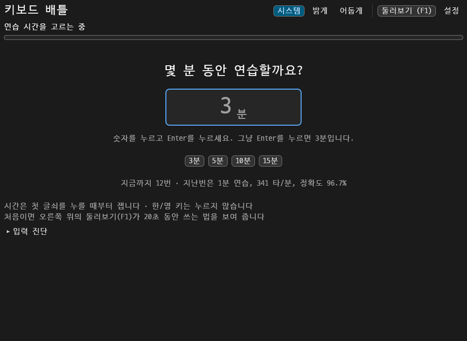

# 키보드 배틀 (keyboard_battle)

영문 · 국문 · 러스트 코드를 한 프로그램에서 연습하는 타자 프로그램입니다.
설치 없이 실행 파일 하나로 동작하는 것을 목표로 합니다.

- **타수 측정** — 영문 WPM, 국문 타/분, 코드 분당 글쇠 수
- **손 풀기** — 열 손가락을 고르게 쓰도록 문장을 골라 주는 준비운동
- **세 가지 연습** — 영문, 국문, 러스트 코드를 5 · 10 · 15분 코스로

> 지금은 문장 네 개짜리 **과정**을 이어서 치며 타수와 정확도를 재는 데까지 되어 있습니다.
> 5 · 10 · 15분 코스, 손 풀기, 기록 저장은 아직 없습니다.



프로그램에 글쇠를 일정한 간격으로 보내며 찍은 시연입니다. 사람이 친 것이 아니어서, 화면에 나오는 속도와 정확도는 시연 대본의 것입니다.

## 연습 화면

과정 하나는 문장 네 개(한글 둘, 영문 하나, 러스트 하나)입니다.
문장은 켤 때마다 다르게 섞여 나오고, 실린 문장을 다 칠 때까지 같은 문장이 다시 나오지 않습니다.

- **문장 블럭** — 문장마다 블럭 하나입니다. 지금 칠 블럭은 테두리가 굵고, 그 안에서 지금 칠 낱말에 밑줄이 그어집니다.
  문장을 끝내면 블럭이 잠깐 초록으로 빛나고, 그 문장의 속도와 정확도가 남습니다.
- **진행 표시** — 위쪽에 과정 번호, 문장 번호, 진행률과 막대가 있고, 오른쪽에 지금까지의 속도 · 정확도 · 시간이 1초에 한 번씩 바뀝니다.
- **결과 창** — 과정을 끝내면 속도와 정확도, 지난 과정과의 차이, 다음에 바꿔 볼 한 가지, 문장별 기록, 자주 틀린 글쇠, 문장에서 틀렸던 자리가 뜹니다.
  `Enter`를 누르면 새 문장으로 넘어가고, `R`을 누르면 같은 문장을 다시 치고, `V`를 누르면 방금 친 과정을 처음부터 되감아 봅니다.
- **둘러보기** — 오른쪽 위 **둘러보기**나 `F1`을 누르면, 프로그램이 첫 문장을 스스로 쳐 보이며 20초쯤 화면을 설명합니다.
- **집중 화면** — 치는 동안에는 제목, 단추, 도움말이 흐려집니다. 손을 2초 멈추거나 마우스를 움직이면 돌아옵니다.

문장은 끝까지 정확히 쳐야 다음으로 넘어갑니다. 틀린 글자는 `Backspace`로 지우고 다시 칩니다. `Esc`는 줄을 비웁니다.
틀린 줄 모르고 계속 쳐도 친 글이 문장보다 길어지지는 않습니다.
문장의 글자 크기는 창 너비를 따라가서, 창을 줄여도 가장 긴 문장이 한 줄에 들어옵니다.

### 설정

오른쪽 위에서 고릅니다. 고른 값은 아직 저장되지 않아, 프로그램을 다시 켜면 처음으로 돌아갑니다.

| 항목 | 고를 수 있는 것 (앞의 것이 처음 값) |
|---|---|
| 화면 밝기 | 시스템 · 밝게 · 어둡게 |
| 지금 칠 낱말 | 밑줄 · 바탕 · 표시 없음 |
| 친 글 | 아래 줄에 · 문장 위에 겹쳐 |
| 집중 화면 | 치는 동안 주변을 흐리게 · 끔 |

**문장 위에 겹쳐**를 고르면 친 글을 따로 보이지 않고 칠 문장 위에 바로 색을 입힙니다.
맞게 친 글자는 초록, 틀린 자리는 빨강이며, 틀린 자리에는 쳐야 할 글자가 그대로 보입니다.

## 타수와 정확도

- **타수**는 문장을 치는 데 누르는 글쇠 수입니다. 한글은 낱자마다, 그 밖의 글자는 글자마다 1타로 세고 Shift는 세지 않습니다.
  예를 들어 '값'은 ㄱㅏㅂㅅ 4타입니다.
- **속도(타/분)** 는 문장의 첫 글쇠를 누른 순간부터 잽니다. 첫 글쇠는 시계를 켜는 신호이므로,
  그 뒤에 친 글쇠 수를 걸린 시간으로 나눕니다. 과정의 속도는 네 문장의 글쇠 수와 시간을 각각 더해 구하며,
  문장 사이에 쉬는 시간은 들어가지 않습니다.
- **WPM**은 다섯 글자를 한 낱말로 친 값이고, 영문 문장에만 함께 보여 줍니다.
- **정확도**는 누른 문자 글쇠 가운데, 누르고 난 글이 문장과 어긋나지 않았던 글쇠의 비율입니다.
  틀린 글쇠는 고친 뒤에도 정확도에 남습니다. `Backspace`는 세지 않습니다.

- **고치는 데 쓴 시간**은 틀린 글쇠를 누르고, 지우고, 지운 자리를 다시 치는 데 든 시간입니다.
  글쇠 하나를 눌러 문장을 새로 한 자리 나아갔으면 맞게 친 시간이고, 아니면 고친 시간입니다.
  맞게 친 시간만으로 낸 속도가 **틀리지 않았다면의 속도**입니다.

다른 프로그램과 계산 방식이 달라 숫자가 똑같지는 않습니다. 이 프로그램 안에서의 변화로 보세요.

## 다음엔 이렇게

결과 창은 방금 친 기록을 되짚어, 속도와 정확도를 올리려면 다음에 무엇을 바꿔 치면 좋을지 **한 가지만** 권합니다.
위에서부터 차례로 살펴 처음 해당하는 것을 고르고, 그 아래에 근거가 된 숫자를 함께 적습니다.

| 이런 기록이면 | 이렇게 권합니다 |
|---|---|
| 정확도가 95%에 못 미친다 | 손을 조금 늦춰 틀리지 않고 치기. 고치는 데 쓴 시간과 틀리지 않았다면의 속도를 보여 줍니다 |
| 이번에도 틀린 글쇠 가운데 거듭 틀린 것이 있다 (두 번 이상, 쳐야 했던 횟수의 열에 하나 이상) | 그 글쇠 앞에서 한 박자 늦추기. 어느 손가락이 어느 줄에서 치는 글쇠인지 알려 줍니다 |
| 낱말의 첫 글쇠가 낱말 안의 글쇠보다 두 배 이상 걸린다 | 낱말을 치는 동안 다음 낱말을 미리 읽기 |
| 어떤 글쇠가 다른 글쇠보다 1.6배 이상 걸린다 | 그 글쇠의 자리를 손에 익히기. 손가락과 줄을 알려 줍니다 |
| 정확도가 98% 이상이다 | 지금보다 5% 이상 올린 속도를 목표로 삼기 |
| 그 밖에 | 지금 속도를 지키면서 틀린 글쇠를 하나만 줄이기 |

글쇠별 기록은 과정 하나로는 모자라서 프로그램을 켜 둔 동안 친 것을 모아서 봅니다. 아직 저장하지 않으므로 다시 켜면 처음부터 모읍니다.
기준 숫자는 처음 잡아 본 값이고, 사람이 쳐 본 기록으로 맞춰 가야 합니다.

## 입력 방식

OS 입력기를 쓰지 않고, 눌린 글쇠의 자리를 직접 읽어 프로그램 안에서 한글을 조합합니다(두벌식 · 쿼티).
그래서 한/영 키를 누르지 않아도 칠 문장에 맞춰 한글과 영문이 바뀌고,
윈도우와 맥에서 똑같이 동작하며, 어느 손가락을 썼는지 글쇠 단위로 알 수 있습니다.

## 실행

### 윈도우

1. 이 저장소의 **Actions** 탭에서 가장 최근에 성공한 **CI** 실행을 엽니다.
2. 아래쪽 **Artifacts**에서 `keyboard_battle-windows`를 받아 압축을 풉니다.
3. `keyboard_battle.exe`를 실행합니다.

아직 코드 서명 전이라 "Windows의 PC 보호" 창이 뜹니다. **추가 정보 → 실행**을 누르면 됩니다.
창이 뜨지 않으면 exe 옆에 생기는 `keyboard_battle_error.txt`에 이유가 적힙니다.

### 직접 빌드

[러스트](https://rustup.rs)가 있으면 어느 OS에서든 됩니다.

```sh
cargo run --release
```

### 브라우저에서

같은 프로그램을 웹용으로도 빌드할 수 있습니다.

```sh
web/build.sh
python3 -m http.server --directory target/web-dist
```

그런 다음 `http://localhost:8000`을 엽니다. CI의 **Artifacts**에 있는 `keyboard_battle-web`에도 같은 묶음이 들어 있습니다.

저장소 **Settings → Pages**에서 Source를 **GitHub Actions**로 바꿔 두면,
`main`에 반영될 때마다 `https://ahnchul0-hue.github.io/keyboard_battle/`에 올라갑니다.

브라우저에서는 OS 입력기가 끼어드는 방식이 달라, 윈도우 실행 파일의 입력 확인을 대신하지는 못합니다.

## 입력 확인 방법

한글 입력이 OS 입력기 상태와 무관하게 되는지는 실제 PC에서 쳐 봐야 알 수 있습니다. **한/영 키는 누르지 않습니다.**

1. OS 입력기를 **영문** 상태로 두고 과정 하나를 끝까지 칩니다.
2. OS 입력기를 **한글** 상태로 바꾸고 다음 과정을 칩니다.
3. 화면 아래 **입력 진단**을 펼쳐 **확인 결과 복사**를 누르고, 그 내용을 알려 주세요.

## 단계

| 단계 | 내용 | 상태 |
|---|---|---|
| 0 | 창 띄우기, 글쇠 자리 읽기, 한글 조합기 | 실제 윈도우 PC 확인 대기 |
| 1 | 영문 타수 측정 | 과정 단위로 측정 |
| 2 | 국문 타수 측정 | 과정 단위로 측정 |
| 3 | 러스트 코드 연습 | 한 줄 코드만 |
| 4 | 5 · 10 · 15분 코스, 손 풀기 | |
| 5 | 기록 저장과 요약 | 결과 창만 (저장 없음) |
| 6 | 맥용 포장 | |

## 구조

| 파일 | 하는 일 |
|---|---|
| `src/hangul.rs` | 두벌식 한글 조합기 |
| `src/keymap.rs` | 글쇠 자리와 쿼티 · 두벌식 배열, 글쇠마다 맡는 손가락 |
| `src/typed.rs` | 지금까지 친 글 |
| `src/measure.rs` | 타수와 정확도 계산 |
| `src/texts.rs` | 연습 문장과, 문장을 섞어서 내는 묶음 |
| `src/round.rs` | 과정 하나의 진행과 기록 |
| `src/coach.rs` | 끝낸 과정을 되짚어 다음에 바꿔 볼 한 가지를 고르기 |
| `src/overlay.rs` | 친 글을 칠 문장 위에 겹쳐 보일 때 글자마다의 상태 |
| `src/player.rs` | 적어 둔 일을 제때에 다시 해 보이기 (다시 보기, 둘러보기) |
| `src/tour.rs` | 둘러보기 대본 |
| `src/app.rs` | 연습 화면 |
| `src/result.rs` | 결과 창 |
| `src/settings.rs` | 설정 |
| `src/input.rs` | 글쇠 입력 읽기와 입력 진단 |
| `src/view.rs` | 문장 블럭과 진행 막대 그리기 |
| `src/theme.rs` | 화면 밝기 전환, 색, 글자 크기 |
| `web/` | 브라우저용 화면 틀과 빌드 스크립트 |
| `tools/record_demo.sh` | 위의 시연을 다시 찍는 스크립트 (리눅스) |

```sh
cargo test                                  # 테스트
cargo clippy --all-targets -- -D warnings   # 검사
```

## 연습 문장

예부터 전해 오는 속담과 글귀, 그리고 이 프로그램을 위해 새로 쓴 문장과 코드만 싣습니다.
한글 60문장, 영문 30문장, 러스트 30줄이 있어 서른 과정을 쳐야 한 바퀴를 돕니다.

늘 같은 문장으로 시작해야 할 때(시연, 두 PC의 비교)는 섞지 않고 실린 순서대로 내게 할 수 있습니다.
실행 파일에는 `--in-order`를 붙이고, 브라우저에서는 주소 끝에 `#in-order`를 붙입니다.

## 라이선스

- 코드: [MIT](LICENSE)
- 글꼴: [D2Coding](https://github.com/naver/d2codingfont) (NAVER) —
  [SIL Open Font License 1.1](assets/fonts/D2Coding-OFL.txt). 고치지 않은 원본을 실행 파일에 넣습니다.
